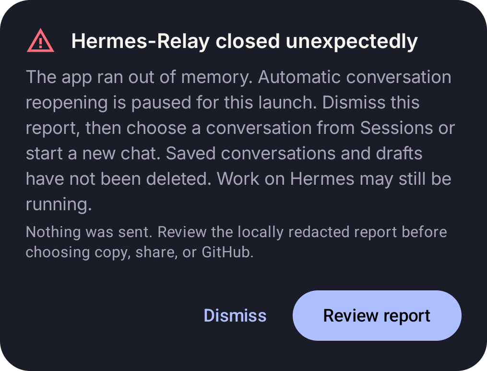

# Android conversation memory recovery

## Release evidence

Issue [#700](https://github.com/Codename-11/hermes-relay/issues/700) reports
Google Play 1.18.1 (version code 59) exhausting its 256 MiB heap while sending
in a long conversation, then crashing repeatedly when that conversation reopens.
The failed 576-byte allocation is the final failed allocation, not a frame size.

The immutable `android-v1.18.1` tag resolves to
`ca941b6ac999f74fff72e3363eb852cf5cbecb12`. The published Play AAB has SHA-256
`df89e47194a0fce71d2e6328d948a8e14ee4eb5489703c692920f252d759251c`.
Its embedded `BUNDLE-METADATA/com.android.tools.build.obfuscation/proguard.map`
has SHA-256 `ff6825451d86d7f83f25a172ed16bcefd0e0934f601df6d8e44af851ec6cd912`.
That exact mapping resolves `ua3.onMessage(SourceFile:51)` to
`GatewayChatClient.handleFrame` at release source line 3920, inlined through the
listener at line 3798. The failing expression is `json.parseToJsonElement`.

This identifies the Gateway listener, but not the RPC/event or frame contents.
It does not establish whether one oversized frame, retained history, decoding
copies, rendering pressure, or a combination exhausted the reporter's heap.
Markdown issue #465 and attachment issue #531 remain separate failures.

The text frame had already reached the listener. Parsing can retain that text
alongside decoded strings, escape-decoding buffers and the JSON tree. The
visible transcript and rendering allocations share the heap, but this stack
does not measure their contribution or demonstrate a retained-state leak.

## Binding without duplicate display history

Android's visible Gateway transcript is loaded by the profile-scoped Dashboard
HTTP history reader. Gateway resume and activation still supply live identity,
model/profile information, in-flight output, queued work and open requests.
Their `messages` display-history array is unused by foreground send and recovery.

The prewarm path already requested `omit_messages`; cold send, checkpoint resume,
checkpoint activation and mid-turn activation now request it as well. This
avoids serializing, buffering and decoding the redundant history array on
supporting upstream versions. It does not limit or delete HTTP history and does
not omit in-flight output. Child-watch resume still requests its history because
that consumer uses the returned rows. Existing prewarm `defer_history` behavior
is unchanged; send/recovery do not newly defer server initialization.

The upstream contract was inspected at
`NousResearch/hermes-agent@f9bdaa303e1614245cf1104db52ed0efd90b6f13`:
`tui_gateway/methods_session.py` reads `omit_messages` for resume and activation;
`_Resume.messages` and `tui_gateway/session_registry.py::_live_session_payload`
skip display projection when requested. The latter retains live state and open
requests. Older servers may ignore this additive option and retain the larger
response. The client still buffers complete WebSocket frames and parses JSON
trees; this change is not a universal incoming-frame memory bound.

PR [#709](https://github.com/Codename-11/hermes-relay/pull/709), reviewed at
`86b5a27eaa50822ff63aa8e8beb205905fcd4364`, changes HTTP history pagination to
include compacted rows. It can increase retained visible history, but does not
change this WebSocket decoder. Its history change is not incorporated here.

## Recovery after process death

At application startup, a pending locally recorded `OutOfMemoryError` latches
a pause before the process chat runtime binds. Automatic profile/session
reconciliation opens an empty view and leaves the remembered session slot,
composer drafts and turn checkpoints intact. The session directory remains
available. Socket-only warmup can establish readiness, but automatic session
attachment/checkpoint recovery stays paused.

The existing crash dialog explains how to dismiss the report and choose a
conversation or start a new chat. Dismissing the report does not lift the pause
in that process; explicit conversation selection or a new send does. Retrying
the same oversized conversation on an older server may still fail. Capture must
have succeeded before process termination for the recorded-crash gate to apply.

## Verification lanes

- `GatewayChatClientTest` uses real loopback HTTP/WebSocket transport with
  bounded synthetic tool history. Send, activation, fallback resume and socket
  rejoin must omit unused rows while preserving session identity and live state.
- `GatewayPayloadMemoryTest` runs the production JSON library in a separate
  128 MiB JVM with UTF-16 strings, a fixed 16 MiB retained allocation and a
  synthetic 32 Mi-character escaped frame. Reading and decoding are separate
  phases. It distinguishes decoder OOM from input-buffer failure, then repeats
  metadata-only decoding. This is controlled pressure, not Pixel/ART profiling
  or a measurement of the reporter's conversation.
- `ChatMemoryRecoveryTest` checks directory access, deferred history/checkpoint
  loading, saved selection and draft preservation, and explicit reopening.
- `ChatMemoryRecoveryInstrumentedTest` exercises the production crash dialog,
  dismissal, lifecycle return and explicit history loading on Android.
- The shared `initial_history_bind` scenario checks metadata-only resume and
  activation while retaining full HTTP history. Its manifest is checked against
  current upstream. The source checker follows called local resume helpers so
  upstream extraction does not masquerade as contract removal.

No private conversation data or production payload is required by these tests.
Actual Pixel 8 Pro / Android 17 behavior and the reporter's exact trigger require
separate device evidence; a synthetic test cannot certify them.

## Rendered recovery evidence

The focused `ChatMemoryRecoveryInstrumentedTest` passed on Standard Phone API 36
(Pixel 6 profile, x86_64) at `08ba907721c7e180f37e15a7e45f47fb09f1cbd2`: one test,
zero failures or skips. It exercised the production crash dialog and chat state
under dismissal and Activity lifecycle return, followed by explicit history loading.
The dialog capture uses the default dark app theme in the instrumentation harness;
it is not a physical-device or full production-startup certification.

