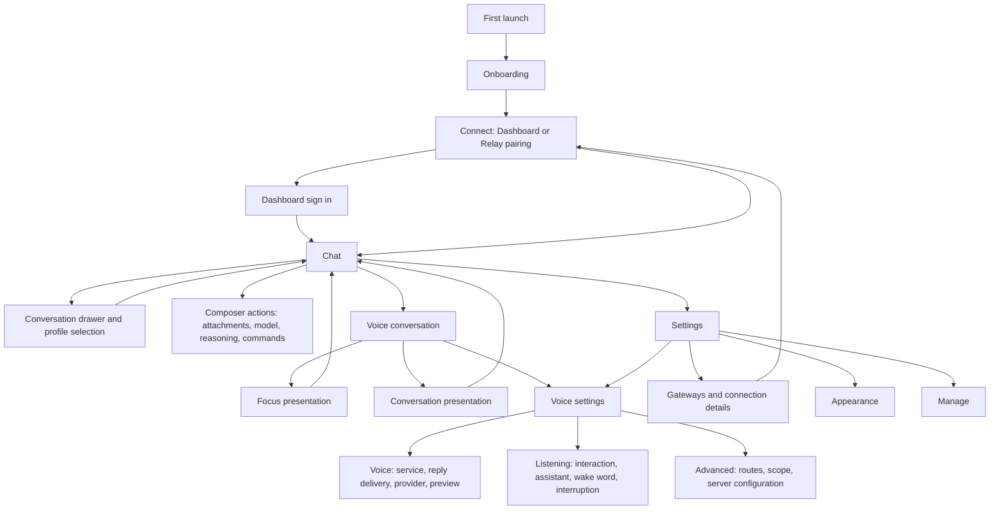

# Material 3 Expressive primary flow

The Clean layout keeps native Android navigation and the existing Hermes identity.
Classic remains an explicit appearance choice. Material 3 is pinned to
`1.5.0-beta01`, including window-size classes. App version and release channels
are independent of the UI library version.

## Primary screen map

| Screen or surface | Primary task | Availability and recovery |
|---|---|---|
| Onboarding | Explain connection and optional permissions; enter setup | Compact windows retain scrollable actions; permission denial does not imply connection failure |
| Connect / pair | Add or re-pair one connection | Keep transient setup separate from saved connections; cancel/back preserves saved data |
| Dashboard sign in | Authenticate the selected Dashboard origin | Preserve native callback, trust and authentication boundaries |
| Chat | Read, compose and send; start voice from the idle waveform action | Keep send, stop and voice mutually meaningful; show reconnect or setup guidance |
| Conversation drawer | Resume a conversation, open Bots, reach Settings from the footer | Cached, loading, empty, unavailable and pagination retry stay distinct |
| Profile inspector and switcher | Inspect or change the active profile | Identity and unread state stay connection/profile scoped |
| Composer action sheet | Attach camera, photos, files or clipboard; change model/effort; browse commands | Scrollable at large text and in short windows; unavailable actions remain gated |
| Voice conversation | Start/stop listening and hear responses | Preserve microphone permission, hold/tap/continuous input, retry and explicit exit |
| Focus voice | Converse with fewer visual distractions | Preserve transcript, current state, presentation switch and settings access |
| Conversation voice dock | Converse while reading the chat | Preserve transcript ownership, pause/stop and return to the full presentation |
| Settings | Grouped landing: Assistant (Voice, Chat, Media, Inspect agent, Profile lock), Connection, Hermes, Relay tools, App, Help & info | Relay tools fold into one expandable row until Relay is set up; Bridge safety is reached from Bridge | Category descriptions wrap in Clean rather than hiding at large text |
| Voice / Voice tab | Choose Chat voice or Live conversation, then configure output | Chat voice works with upstream Dashboard; live conversation requires Relay; provider options remain server supplied |
| Voice / Listening tab | Configure tap/hold/continuous, assistant, wake word and interruptions | Preserve Android role selection, permissions, install progress and test failures |
| Voice / Advanced tab | Diagnose/select audio route and edit server configuration | Preserve sign-in actions, route readiness, profile scope and explicit save/error behavior |
| Gateways | Select, add or edit a saved connection | No implicit transport migration or credential changes |
| Connection details | Inspect Overview, Routes, Advanced and Security | Endpoint-specific readiness and exact-origin security consent remain authoritative |
| Appearance | Select theme, layout, font, scale and shape | Custom themes, system contrast and user-selected Classic remain supported |
| Manage | Manage upstream profiles, models, skills and configuration | Uses Dashboard authentication independently of chat socket readiness |

## First-run pages

| Page | Purpose |
|---|---|
| Welcome | Explain the app and offer setup or the offline demo |
| Chat | Introduce conversations and chat capabilities |
| Manage | Introduce Dashboard-backed management |
| Power | Explain optional Relay tools and permission access |
| Connect | Complete the connection wizard and sign-in before advancing |
| Permissions | Review optional Android permissions after connection setup |

## Supporting destinations

These remain secondary destinations rather than competing with chat and voice:

| Group | Destinations |
|---|---|
| Chat and media | Chat settings, Media settings, Threads/proactive settings |
| Relay tools | Terminal, Bridge/device control, Bridge safety, Relay sessions, Plugins/plugin pages, Git workspace |
| Accounts and health | Usage & limits, Analytics, Permissions, Diagnostics |
| Appearance extensions | Custom theme editor, Petdex, custom pet guide |
| Restricted and developer tools | Supervised appearance/controls, Advanced settings, Developer settings, realtime test, About/changelog, Bot mode/chat |

## Interaction and visual contract

- Native Material tabs expose selection and support horizontal scrolling at enlarged text. Tabs stay visible while each tab's content scrolls; the profile summary scrolls with content so it cannot consume a short window.
- Service choices use a single radio group, full-row touch targets and semantic container colors. Live conversation explains its Relay requirement even when unavailable. Existing saved engine and route values are retained.
- Each Voice tab keeps its own scroll position across tab switches and recreation; switching connection or profile resets them.
- Tapping voice when the Dashboard needs sign-in opens Dashboard sign-in directly (supervised mode keeps the warning).
- The first Voice tab contains everyday service and output choices. Route selection, scope and host configuration remain under Advanced. The summary returns to the Voice tab.
- Clean uses the official `MotionScheme.expressive()` at the theme root, including separately hosted themed windows. Custom composer/appearance transitions use the same library specs. Classic uses the standard scheme.
- Existing semantic palettes, chosen fonts and shape preferences remain authoritative. Clean voice cards and Settings categories use tonal surfaces; Classic retains its outlines and decorations.

## Validation

Focused checks cover service selection, disabled Relay-only selection, native tab
selection, 200% text at 320dp, existing Clean composer/sheet captures, route
coercion, profile-scoped voice preferences and voice presentation interactions.
Generated captures live under `app/build/ui-regression/`. These rendered tests do
not certify live microphone, provider audio, Android assistant or physical-device
behavior.

References: [Material 3 release notes](https://developer.android.com/jetpack/androidx/releases/compose-material3#1.5.0-beta01),
[Material motion](https://m3.material.io/styles/motion/overview/how-it-works),
[Material color roles](https://m3.material.io/styles/color/the-color-system).

## Reference app rationale

ChatGPT's documented mobile voice flow starts from a voice action in the message
bar, preserves the chat transcript, and provides explicit microphone and exit
controls. Its Voice settings separate the everyday voice choice from background
conversation preferences. Its Android history lives in a sidebar. Hermes follows
those familiar navigation patterns while keeping its own provider, profile,
Relay-availability and permission rules.

The composer keeps attachments in its add sheet, one relevant trailing action,
and a conversation voice dock that can expand into Focus. Voice configuration
begins with the service choice; provider-specific configuration follows the
selected service rather than competing with the initial choice. Optional Relay
and device-control tools remain secondary destinations.

Sources: [ChatGPT Voice](https://help.openai.com/en/articles/20001274-chatgpt-voice),
[ChatGPT Android FAQ](https://help.openai.com/en/articles/8142208-chatgpt-android-app-faq).

Gemini Live provides a second reference for explicit pause/end controls,
interruptible replies and continuity between voice and text. Hermes keeps those
controls in its existing dock and Focus presentation, with listening and
interruption preferences grouped together rather than mixed with server routes.
See [Gemini Live on Android](https://support.google.com/gemini/answer/15274899?hl=en).

## Observed verification on 2026-10-17

The focused voice/composer/onboarding/preferences/route checks passed on both
flavors, 51 tests each. Both debug APK assembly tasks completed with the final
translations. Android lint completed with zero errors, 988 warnings and 42 hints.
Phone and tablet-sized Android emulator captures confirm the primary chat and
Settings hierarchy; 200% text service selection is covered by the rendered tests.
The Google Play debug package was updated in place on the physical Galaxy and
launched successfully. Live audio and locked-device visual acceptance are not
certified. The independent native pet screenshot harness gap is tracked in
[the project TODO](../project/TODO.md).

## Navigation simplification (2026-10-17)

- Drawer follows ChatGPT's sidebar: search and new chat on top, **Bots** as a
  visible primary entry (was hidden in the Clean overflow), then conversations,
  with **Settings** pinned to the footer in both layouts.
- "Bot Mode" is now "Bots" everywhere a user sees it (ADR 67's workspace is unchanged).
- The chat ⋮ menu lists conversation actions first (copy ID, search, share), then
  Terminal. Settings appears there only when supervised mode hides the drawer.
- Settings rows match their destination titles ("Manage").
